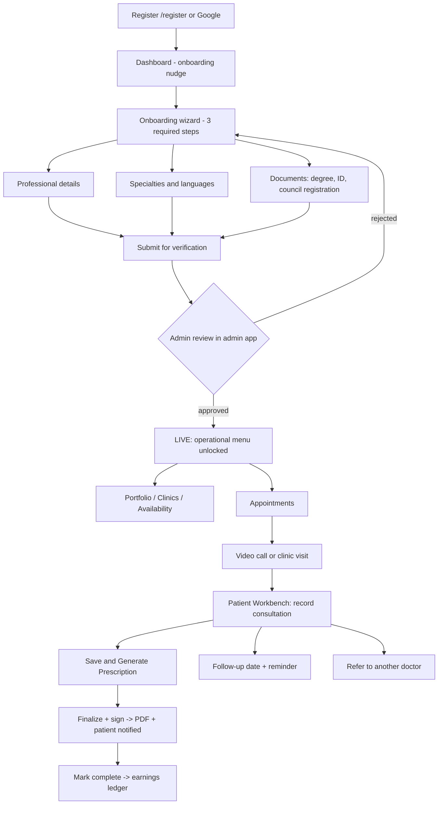

# Application Overview - IHS Doctor Portal

## 1. Purpose

`frontend-doctor` is the practitioner-facing web application of the India One Health System. It is deployed as its own site (the "doctor subdomain", port 3001) next to the patient site (main domain, port 3000), the admin console (3002) and the clinic portal (3003). It is **doctor-only**: the sign-in form sends `audience: "doctor"` to the backend, which rejects patient/other accounts with `403 WRONG_PORTAL`, and `useLogin` additionally clears the session if the returned role is not `doctor`.

The root URL has no landing page: `src/proxy.ts` redirects `/` to `/login` (no session) or `/dashboard` (session present). `robots: { index: false }` is set in the root layout - this is a signed-in console.

## 2. Users and roles

| Role | Can use this app? | How it is enforced |
|---|---|---|
| doctor | Yes - the only intended user | Backend `audience: "doctor"` on login; client re-check of `user.role`; backend `authenticate` + role guards on every `/doctor/*` call |
| patient | No | `WRONG_PORTAL` toast with a "Go to patient site" action (`NEXT_PUBLIC_PATIENT_URL`) |
| admin / staff / clinic | No | `roleLabel` has entries for `admin`/`staff` but the nav does not branch on role (`dashboardNavForRole` ignores its argument) |

A doctor's capabilities are additionally gated by **verification status** (`pending | approved | rejected`): operational sidebar items (Patient Portal, Appointments, My Patients, Follow-up options, Referrals, Prescriptions, My Medicines, Earnings) are hidden until the profile is `approved` ("live"). Portfolio, Clinics, Availability and Settings are always visible.

## 3. Doctor journey

Admin review itself lives in `frontend-admin`; this app only shows the resulting status.

## 4. Feature status matrix

Status legend: **Implemented (verified)** = code read and wired to a real endpoint; **Partially implemented**; **Documented-but-not-found** = an old doc promises it, no code found; **Planned**; **Unclear**.

| Feature | Status | Evidence (source) |
|---|---|---|
| Doctor registration (email/password) | Implemented (verified) | `features/auth/components/RegisterForm.tsx`, `POST /auth/register` with `role: "doctor"` |
| Google sign-in / sign-up | Implemented (verified), conditional | `GoogleAuthButton`, shown only when `NEXT_PUBLIC_GOOGLE_CLIENT_ID` set; otherwise a placeholder button |
| Email or mobile login | Implemented (verified) | `doctorLoginSchema`, `normalizeMobile` |
| OTP password reset (SMS or email) | Implemented (verified) | `ForgotPasswordPanel`, `OtpResetForm`, `/auth/forgot-password/otp[/verify]` |
| Emailed reset link | Implemented (verified) | `ResetPasswordForm`, `/reset-password?token=` |
| Admin login form | Partially implemented | `AdminLoginForm` + `useAdminLogin` exist in `features/auth` but no route renders them |
| Change password | Documented-but-not-found | `API_ENDPOINTS.auth.changePassword` is defined; no caller |
| Profile (name, phone) update | Partially implemented | `SettingsView` + `useUpdateProfile` exist in `dashboard/components/pages.tsx` but `/dashboard/settings` renders `PortfolioEditor` + `PaymentQrCard`, not `SettingsView` |
| Onboarding wizard + verification banner | Implemented (verified) | `OnboardingWizard`, `VerificationBanner`, `OnboardingNudge` |
| Bank / payout details | Planned | Shown as locked "coming soon" step in the wizard |
| Specialization / sub-specialization | Implemented (verified) | `SpecialtiesStep` (max 5 / 10, "+ Add new sub-specialty") |
| Portfolio editor and preview | Implemented (verified) | `PortfolioEditor`, `PortfolioPreview`, `PortfolioSections`, `DoctorProfileView` |
| Clinics, map pin | Implemented (verified) | `ClinicsManager`, `ClinicForm`, `ClinicLocationPicker` |
| Weekly availability, blocked dates | Implemented (verified) | `AvailabilityManager` -> `AvailabilityStep` |
| Consultation queue (token) model | Implemented (verified) | `WeeklySlot` doc: window = session, patients take a token (old doc says "Planned") |
| Appointments board | Implemented (verified) | `AppointmentsBoard` (1,853 lines) |
| Reschedule / complete / no-show / mark paid | Implemented (verified) | `appointmentService` |
| Video consultation | Implemented (verified) | `ConsultationRoom`, `/appointments/[id]/call` |
| Patient workbench (EMR) | Implemented (verified) | `features/emr` |
| Diagnosis with ICD search | Implemented (verified) | `emrService.searchIcd/searchDiagnoses`, `EntryPanels` |
| Investigations | Implemented (verified) | `searchInvestigations`, `investigation` entry kind |
| Prescriptions + letterhead | Implemented (verified) | `features/prescriptions` |
| Medicine management | Implemented (verified) | `features/medicines`, `MedicinePicker` |
| Treatment timeline / My Patients | Implemented (verified) | `features/timeline` |
| Follow-up categories + reminders | Implemented (verified) | `features/follow-ups` |
| Referrals | Implemented (verified) | `features/referrals` |
| Analytics (Dashboard 2.0) | Implemented (verified) | `features/analytics` |
| Earnings | Implemented (verified) | `EarningsView`, `EarningsLedger` |
| Notifications | Partially implemented | Bell + dropdown only; code comment: "doctor site has no notifications page"; no websocket client in this app (polling 60 s) |
| Record reader (continuous scroll) | Implemented (verified) | `features/records`, mounted in `PatientDescriptionView` |
| Vitals reference-range colouring | Implemented (verified) | `features/appointments/vitalStatus.tsx` (thresholds come from backend) |
| Reconciliation | Documented-but-not-found (backend) | `ReconciliationPage` states the backend has no model and renders no data |
| Public doctor directory / map / contact | Not in this app | redirect to patient app |
| Automated tests | Documented-but-not-found | no test files or runner |

## 5. Non-functional characteristics

* **Responsive**: MUI breakpoints (xs 0 / sm 600 / md 900 / lg 1200 / xl 1536); mobile drawer navigation, collapsible desktop rail; phone-width stacked layouts in tables (e.g. medicine list).
* **Accessible touches**: `aria-label`s on icon buttons, focus-visible handling in the sidebar, vitals shown with arrows not colour alone (WCAG 1.4.1), `MotionConfig reducedMotion="user"`.
* **Resilient**: offline banner, reconnect-with-backoff on boot when the server is rate-limiting, safe-method retries, refresh-token race handling across tabs.
* **Time zone**: clinical "today" uses the Asia/Kolkata calendar day (`features/emr/format.ts`, `features/analytics/range.ts`).
