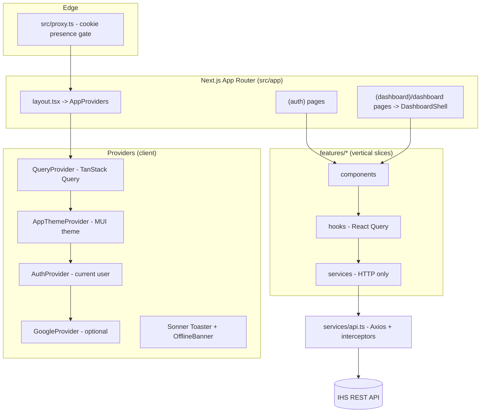
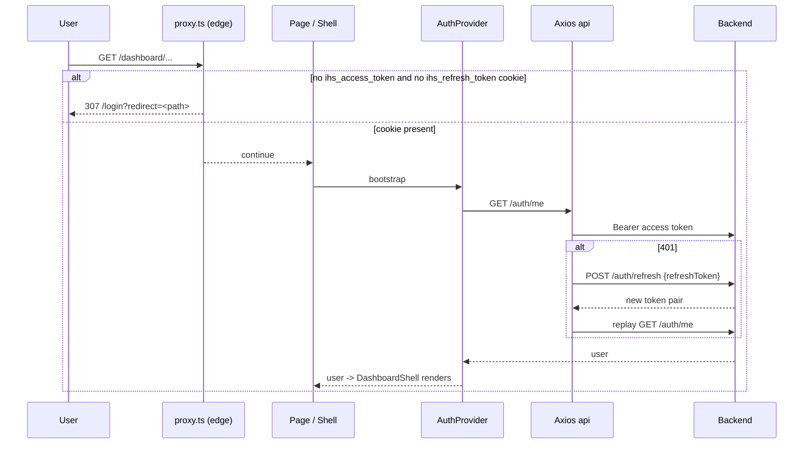

# Architecture - IHS Doctor Portal

## 1. Layered view

Provider order (`src/providers/AppProviders.tsx`): `QueryProvider` -> `AppThemeProvider` -> `MotionConfig(reducedMotion="user")` -> `AuthProvider` -> `GoogleProvider` (only if a client id is set) -> children, plus `CustomCursor`, Sonner `<Toaster richColors closeButton position="top-right">` and `OfflineBanner` beside the children.

## 2. Rendering model

* Pages under `src/app` are mostly **server components** that only render a client feature component and export `metadata`. Pages that need route params at runtime on the client (`call`, `history`, workbench record pages, `patients/[patientId]`) are `"use client"` and use `useParams()`.
* All data fetching is **client-side** (Axios + React Query). There is no use of server actions, route handlers (`app/api`) or server-side fetch to the backend. The only server-side logic is `proxy.ts` and three `redirect()` pages.
* `next.config.ts`: `reactCompiler: true` (React Compiler via `babel-plugin-react-compiler`), `output: "standalone"`, and `experimental.turbopackFileSystemCacheForDev: false` (dev cache disabled because it restored a stale route table on Windows).
* `app/template.tsx` fades each client navigation in (opacity only; first load not animated to avoid hydration mismatch).

## 3. Request lifecycle

`DashboardShell` shows `<Loading>` until `useAuth().user` exists (and a "server is busy - reconnecting" message when `isReconnecting`), then `router.replace("/login")` if not authenticated.

## 4. Cross-cutting concerns

| Concern | Where | Behaviour |
|---|---|---|
| Auth tokens | `utils/auth-token.ts` | cookies `ihs_access_token` (1 day), `ihs_refresh_token` (30 days), `sameSite: lax`, `secure` on https, optional shared domain |
| Refresh | `services/api.ts` | single-flight queue; cross-tab race guard; only 401/403 from refresh clears tokens |
| Retries | `services/api.ts` | GET/HEAD/OPTIONS/PUT/DELETE, max 2, backoff 400/800 ms + jitter, only on transport errors and only when `navigator.onLine` |
| Uploads | `services/api.ts`, `utils/compressImage.ts` | FormData drops JSON content type; timeout 180 s; images downscaled client-side (max edge 1920, quality 0.82, skip < threshold) |
| Errors | `utils/error.ts` | `normalizeError` -> `ApiError { status, message, errors? }` (field messages from `error.details`); distinct text for offline / timeout / unreachable |
| Server cache | `providers/query-client.ts` | staleTime 30 s, gcTime 5 min, refetch on focus + reconnect, no retry on 401/403/404/429, max 2 retries otherwise |
| Notifications | `features/dashboard/components/NotificationBell.tsx` | poll unread count every 60 s |
| Theme | `theme/` | single static MUI theme, light mode (`InitColorSchemeScript defaultMode="light"`) |
| Time zone | `features/emr/format.ts`, `features/analytics/range.ts` | IST calendar days, independent of browser zone |
| Embedding | `DashboardShell` | when inside an iframe or `?embed=1`, render page content without sidebar/top bar (used by the video-call side panels) |

## 5. Key design decisions visible in code

1. **Workbench is the single source of truth for a prescription.** `RxComposer` is read-only: it renders the draft synchronised from the workbench (`POST /doctor/prescriptions/:id/sync-workbench`) and only signs it.
2. **Server decides access.** EMR pages never hide/unhide data client-side; locked records are absent from responses and the UI offers "Request access".
3. **Clinical thresholds live in the backend.** `vitalStatus.tsx` is presentation only.
4. **The call must not remount.** The call page keeps the LiveKit `<Box>` in the same JSX slot in both full and picture-in-picture modes, so React never tears down tracks.
5. **Two copies of the public-profile renderer exist.** `features/doctors/components/DoctorProfile.tsx` (3,541 lines) in this app and a 3,566-line twin in `frontend-patient`. This app uses `DoctorProfileView` for the in-dashboard "as patients see it" preview (with `onEditSection` pencils) and the legacy `/doctors/[slug]` page. Fixes must be ported to both (see `KNOWN-LIMITATIONS-AND-DISCREPANCIES.md`).
6. **`features/emr/components/HistoryViews.tsx` is also a copied file** shared by value with the patient app (its header says both apps keep an identical copy).

## 6. Dependencies on other IHS apps

| Other app | Interaction |
|---|---|
| frontend-patient | `NEXT_PUBLIC_PATIENT_URL`: `/doctors`, `/map`, `/contact` redirect there; "IHS home page" links; wrong-portal toast |
| frontend-admin | Admin approves/rejects doctors; this app only displays status. `NEXT_PUBLIC_ADMIN_URL` is validated but not used in navigation (grep: only in `env.ts`) |
| Shared cookies | Same cookie names on a shared parent domain give single sign-on across apps |
| backend | All data; see `API-INTEGRATION.md` |
