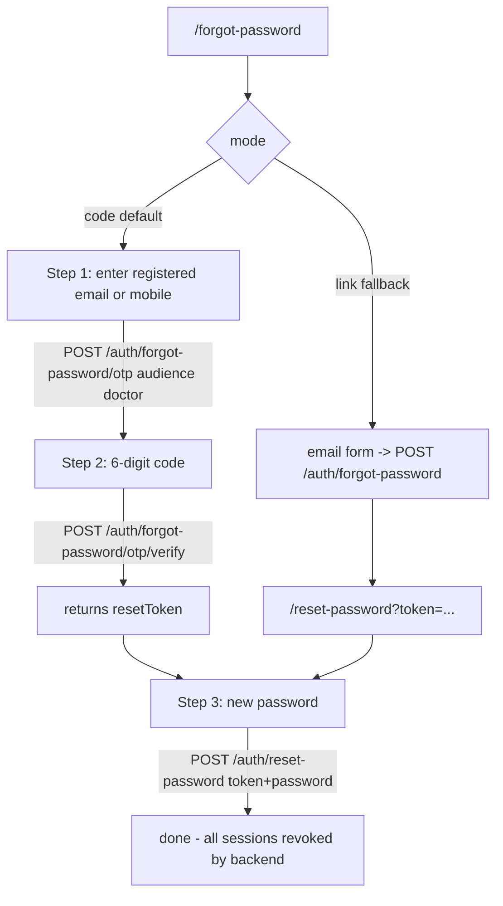

# Authentication, Registration and Permissions

## 1. Registration (`/register`)

`RegisterForm` is **doctor-only**: the persona is hard-coded to `role: "doctor"` (there is no patient path). Only account basics are collected; professional details come later in the onboarding wizard.

| Field | Validation (`features/auth/schemas`, `schemas/common.schema.ts`) |
|---|---|
| Full name | required, min 2 |
| Email | required, valid email |
| Mobile (optional) | Indian mobile `^(\+91[-\s]?)?[6-9]\d{9}$` or empty |
| Password | min 8, at least one uppercase, at least one digit |
| Confirm password | must equal password |
| Accept terms | must be true |

`authService.register` posts only `{ name, email, phone?, password, role }` to `POST /auth/register`, stores the returned token pair in cookies, and `useRegister` sets the user and routes to `/dashboard` (toast "Account created - your profile is pending verification."). Alternative: **Google sign-up** via `GoogleAuthButton role="doctor" text="signup_with"` -> `POST /auth/google { credential, role }` (role only matters for a brand-new account).

`GoogleAuthButton` renders Google's real Identity button only when `NEXT_PUBLIC_GOOGLE_CLIENT_ID` is set (`env.isGoogleEnabled`); otherwise it renders a lookalike placeholder that explains Google sign-in needs a client id.

## 2. Sign in (`/login`)

* One field accepts **registered email or 10-digit mobile** (`doctorLoginSchema`). `parseLoginIdentifier`: anything containing `@` is validated as email; otherwise `normalizeMobile` accepts `98765 43210`, `98765-43210`, `+91 9876543210`, `09876543210`, `91XXXXXXXXXX` and requires `[6-9]\d{9}`.
* `authService.login` posts `{ email | phone, password, audience: "doctor" }` to `POST /auth/login`. Per the code comments, the backend answers `403 WRONG_PORTAL` before issuing tokens for a valid non-doctor account, and a mobile number only ever matches doctor accounts on this app.
* `useLogin.onSuccess` also clears tokens and shows the wrong-portal toast if `user.role !== "doctor"` ("belt-and-suspenders"). The toast has a "Go to patient site" action to `NEXT_PUBLIC_PATIENT_URL`.
* Destination: `?redirect=` (same-origin only, must start with `/` and not `//`) else `/dashboard`.
* Errors surface as Sonner toasts via `getErrorMessage`.

## 3. Password reset

* Step 1 resolves the same way whether or not the account exists; the backend may return `503 SMS_UNAVAILABLE` / `EMAIL_UNAVAILABLE` when the channel is not configured, shown as-is (`channelError`).
* Resend cooldown 60 s (`RESEND_SECONDS`, "matches the backend's `PASSWORD_OTP_RESEND_SECONDS` default").
* New-password policy is the same as signup (`newPasswordSchema`).

## 4. Tokens and session

| Item | Value |
|---|---|
| Cookie names | `ihs_access_token`, `ihs_refresh_token` (`constants/storage.ts`) |
| Lifetimes | access 1 day, refresh 30 days (cookie `expires`; the actual JWT expiry is set by the backend) |
| Cookie flags | `path=/`, `sameSite=lax`, `secure` when the page is https, `domain=NEXT_PUBLIC_COOKIE_DOMAIN` if set. **Not HttpOnly** (set from JS via `js-cookie`) |
| Why cookies | edge `proxy.ts` must read them; shared domain gives single sign-on across the IHS apps |
| Attach | request interceptor adds `Authorization: Bearer <access>` |
| Refresh | on a first 401 -> `POST /auth/refresh {refreshToken}` via a separate bare client (15 s timeout) -> replay; concurrent 401s queue behind one refresh |
| Tab race | if another tab already rotated the refresh token, adopt the new access token instead of logging out |
| Logout | `POST /auth/logout {refreshToken}` best-effort, always clears cookies, clears the React Query cache, `router.replace("/login")` |
| Clear on | only a 401/403 from the refresh call; 429, 5xx and network errors never end the session |

### Bootstrap (`AuthProvider`)

1. No access and no refresh cookie -> unauthenticated immediately.
2. Otherwise `GET /auth/me`; success sets the user.
3. `sessionRejected(err)` is true only for a 403, or a 401 after the refresh token was dropped -> clear tokens.
4. Any other failure (429/5xx/offline) keeps the cookies, sets `isReconnecting`, and retries with exponential backoff (2 s doubling up to 30 s). `DashboardShell` shows "The server is busy - reconnecting, you're still signed in...".

`utils/jwt.ts` (`decodeToken`, `isTokenExpired` with 30 s leeway) exists; the route guard and interceptors do not depend on it.

## 5. Authorization model

### Client side

* **Role**: only `doctor` is expected. The nav does not branch on role; `roleLabel` maps patient/doctor/admin/staff for display.
* **Verification gate**: `visibleNav(items, isLive)` hides operational items until `verificationStatus === "approved"` (menu only; routes stay reachable).
* **Embedding**: `?embed=1` / iframe removes chrome but never the auth gate.

### Server side (what the UI relies on)

Verified by reading `backend/src/routes` (read-only): doctor features sit under `/doctor/*` (`doctor.routes.js`, `doctorBooking.routes.js`, `doctorDashboard.routes.js`, `doctorAnalytics.routes.js`, `doctorEmr.routes.js`, `doctorMedicine.routes.js`, `doctorPrescription.routes.js`, `doctorRecordAccess.routes.js`), and the shared notification feed under `/medicine/notifications`. Code comments in this app state that the doctor id is pinned server-side (analytics) and the patient is derived from the booking (history page) so a doctor cannot point a page at someone else's records.

### Patient-controlled consent (EMR)

Common clinical information (complaint, diagnosis, vitals, advice, follow-up, notes) is visible to a treating doctor. Another doctor's prescriptions, tests and the like are visible only when the patient grants a **consent category**:

| Category | Meaning |
|---|---|
| `medical_history` | past history and long-term conditions |
| `consultations` | other doctors' consultations |
| `diagnoses` | other doctors' diagnoses |
| `medications` | prescriptions / medication |
| `investigations` | tests / investigations |
| `doctor_notes` | other doctors' notes |
| `vitals` | vitals |

`AccessCategoryStatus`: `open | none | granted | pending | rejected | revoked | expired | cancelled`. The doctor can `POST /doctor/emr/patients/:id/access-requests { categories, purpose? }` and cancel via `POST /doctor/access-requests/:id/cancel`. Individual documents can also be shared one-by-one (`via: "document"`) and are read through the audited stream `GET /doctor/access-requests/:requestId/records/:recordId/file`. **Locked data is never in the responses** - the UI cannot reveal it. Every doctor action on a patient is audit-logged server-side; the doctor can read their own trail (`/audit`).

## 6. Security notes specific to this app

* Tokens in JS-readable cookies: XSS would expose them (the code comment suggests moving the refresh token to an HttpOnly backend cookie for hardened setups).
* `dangerouslySetInnerHTML`: not used anywhere in `src`.
* `?redirect=` is validated against open redirects.
* `postMessage` listener in the call page checks `event.origin === window.location.origin`.
* Uploaded files: client mirrors server limits (10 MB for documents/photos, 2 MB for the QR); the server is authoritative.
* No secrets in the bundle: all `NEXT_PUBLIC_*` values are public (Google client id, Maps key - restrict by HTTP referrer).
* `robots: { index: false }` keeps the console out of search engines.
