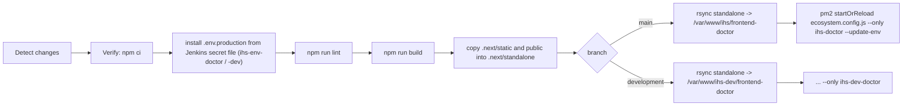

# Deployment Guide

This app is one of several independently deployable apps in the IHS monorepo. Two automation paths exist in the repo at documentation time; the shared system doc `docs-shared/ci/jenkins-setup.md` (plain-text reference) describes the Jenkins history and states that the GitHub Actions workflow now supersedes it.

## 1. Build output

`next.config.ts` sets `output: "standalone"`. `npm run build` produces `.next/standalone/` containing a self-contained `server.js` and the minimal `node_modules` (about 50 MB). Standalone does **not** copy static assets: the pipeline must copy `.next/static` into `.next/standalone/.next/static` and `public/` into `.next/standalone/public`.

Build requirements:
* `NEXT_PUBLIC_*` values present at build time (Zod fails the build otherwise) - see `ENVIRONMENT-CONFIGURATION.md`.
* Enough memory: the Jenkinsfile caps V8 with `NODE_OPTIONS=--max-old-space-size=2048` (default parameter `NODE_HEAP_MB`), `scripts/deploy.sh` uses 1536. A Next production build can take several GB; build with other heavy processes stopped on small machines.
* `reactCompiler: true` needs `babel-plugin-react-compiler` (a dev dependency, so `npm ci` must include dev dependencies when building).

## 2. Runtime layout

| | Production | Development |
|---|---|---|
| pm2 process | `ihs-doctor` | `ihs-dev-doctor` |
| Port (loopback) | 3001 | 3011 |
| Deploy root | `/var/www/ihs/frontend-doctor` | `/var/www/ihs-dev/frontend-doctor` |
| Public host (example from system docs) | `doctor.<your-domain>` -> `127.0.0.1:3001` | `devdoctor.<your-domain>` -> `127.0.0.1:3011` |

From `ecosystem.config.js`: `exec_mode: fork`, `instances: 1`, `script: server.js`, `cwd: <root>/frontend-doctor`, `max_memory_restart: 512M`, env `NODE_ENV=production`, `PORT`, `HOSTNAME=127.0.0.1`, logs under `<root>/logs`. nginx terminates TLS and proxies to the loopback port (forward Host / X-Forwarded-* headers).

## 3. Path A - Jenkins pipeline (`Jenkinsfile`)

Per changed app (detected by `git diff` since the last green build; changes to `Jenkinsfile`, `ecosystem.config.js` or `docs/dbstruct.md` rebuild everything):

* Credentials (names only): `ihs-env-doctor`, `ihs-env-doctor-dev` (secret files holding the build-time `.env`), `ihs-deploy-key`, `ihs-deploy-host`.
* Feature branches / PRs run lint + build only; only `main` and `development` deploy.
* `post { always }` deletes `.env.production` from the workspace.
* There are no tests; "verify" = lint + real build.

## 4. Path B - GitHub Actions + `scripts/deploy.sh`

`.github/workflows/deploy.yml` triggers on push to `main` / `development` (or manual dispatch), SSHes to the VPS and runs `scripts/deploy.sh main|development` in that environment's checkout. The script: `git fetch` + `git reset --hard origin/<branch>`, diff since the last marker (`.last-deploy-commit`), and for each changed app (`doctor` = `frontend-doctor`, kind `next`) runs `npm ci --no-audit --no-fund` and `npm run build` (heap 1536 MB), then `pm2 restart <name> --update-env`. GitHub secrets used: `VPS_HOST`, `VPS_USER`, `VPS_SSH_KEY`.

**Caveat (unverified):** Path B builds inside the git checkout and restarts pm2, while `ecosystem.config.js` launches `server.js` from `<root>/frontend-doctor` (the Jenkins standalone layout). A `next build` in the checkout leaves `server.js` under `.next/standalone`, not at the app root. How the VPS reconciles the two was not verifiable from the repository. Confirm which path is authoritative on the server before changing either; the system docs state Path B is the current mechanism.

## 5. Manual deployment checklist

1. Prepare the build-time env file with production values (no secrets are expected; all are public).
2. `npm ci && npm run build` on a machine with enough RAM.
3. `cp -r .next/static .next/standalone/.next/static && cp -r public .next/standalone/public`.
4. Ship `.next/standalone/` to the server directory used by pm2 (`rsync -az --delete`).
5. `pm2 startOrReload ecosystem.config.js --only ihs-doctor --update-env && pm2 save`.
6. nginx server block for the doctor host -> `127.0.0.1:3001`; TLS via certbot.
7. Smoke test: `/login` loads; sign in as a test doctor; `/dashboard` shows the Overview; the Network tab shows API calls to `NEXT_PUBLIC_API_URL` with no CORS errors; cookie `ihs_access_token` visible on the parent domain.

## 6. Cross-app prerequisites

* Backend CORS must include the doctor origin; `NEXT_PUBLIC_COOKIE_DOMAIN` must be the shared parent domain (leading dot optional) in every IHS web app for SSO.
* Rollback: re-run the pipeline on the previous good commit (the Jenkinsfile does not archive build artifacts), or `git reset` + rebuild on Path B.
* The doctor app has no database or migrations of its own. Backend migrations are run by the backend's deploy step.
