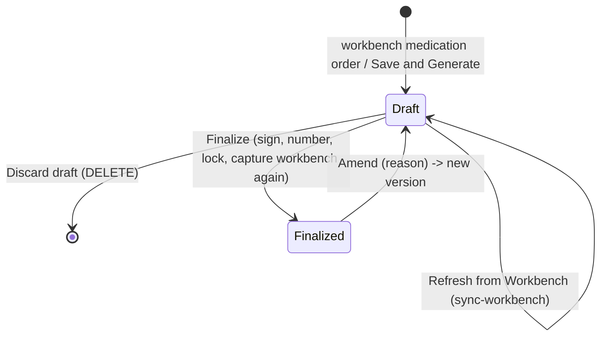
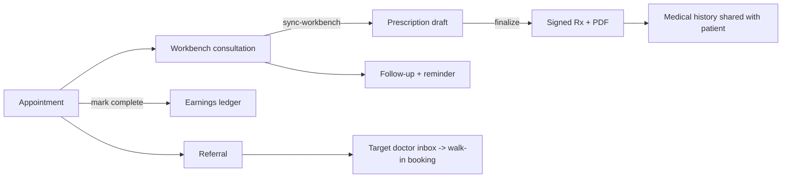

# Features and Modules

Each section lists the entry route(s), the components that implement it, the endpoints it calls, the user workflow, and honest notes. Status labels follow `APPLICATION-OVERVIEW.md`. Every behaviour described here was read in `src/features/*`.

---

## 1. Authentication (`features/auth`)

See `AUTHENTICATION-AND-PERMISSIONS.md` for the full flows. Components: `LoginForm`, `RegisterForm`, `ForgotPasswordPanel` -> `OtpResetForm` (3-step MUI Stepper: Your account / Verify code / New password), `ResetPasswordForm`, `GoogleAuthButton`, `AuthDivider`, `AdminLoginForm` (unrouted). Status: **Implemented (verified)**.

---

## 2. Onboarding and verification (`features/doctor`)

**Route:** `/dashboard/onboarding` (`OnboardingWizard`). **Also:** `VerificationBanner`, `OnboardingNudge` (dashboard card showing n/4 progress; hidden once submitted/approved).

* Server-computed completeness (`GET /doctor/onboarding` -> `steps` map keyed `professional | specialties | portfolio | documents | clinics | availability`, plus `canSubmit`, `isSubmitted`, `verificationStatus`, `verificationNotes`). No wizard cursor is stored; the wizard opens on the first incomplete step.
* **Required (gate) steps = 3**: Professional details; Specialties and languages; Documents (degree certificate, government ID proof, medical council registration; PDF/PNG/JPEG up to 10 MB). The code states it mirrors `ONBOARDING_REQUIRED_STEPS` in the backend, "which is authoritative".
* **Tracked but not gating:** Portfolio, Clinics, Availability (listed under "Your public profile").
* **Deferred:** "Bank details - coming soon" (locked step). Status: **Planned**.
* Submit: `POST /doctor/submit`; on rejection the wizard jumps to the first missing step.
* Banner states: pending and not submitted -> "Finish onboarding"; pending and submitted -> under review; rejected -> notes + "Update and resubmit"; approved -> "Live" + link to the public profile.

### 2.1 Professional details (`ProfessionalStep`, `professionalSchema`)
Qualification (required, max 255), registration number (required, max 100), experience years (0-80), bio (<= 5000), online fee, tagline/headline (required, <= 160), gender (male/female/other, required), practice philosophy (<= 1000), public phone, public email, short intro (<= 500), career summary (<= 2000). Saved with `PATCH /doctor/profile`.

### 2.2 Specialization and sub-specialization (`SpecialtiesStep`)
* Pick up to **5 specialties** (`MAX_SPECS`) from the public catalog (`GET /specializations`).
* Pick up to **10 sub-specialties** (`MAX_SUB_SPECS`) grouped under the parent specialty chosen; picking beyond the cap shows a notice.
* A **"+ Add new sub-specialty"** row (`ADD_NEW_ID = -1`, group "Can't find it?") creates a shared catalog entry via `POST /doctor/catalog/sub-specializations` (find-or-create).
* Languages via `PUT /doctor/languages`.
* Save order (`useSaveSpecialties`): specialties first (server drops sub-specialties whose parent was removed), then sub-specialties validated against the saved specialties; profile cache replaced with the server response and re-synced even on partial failure.
* Display: the top bar shows the specialty names (or qualification) under the doctor's name.

---

## 3. Profile and portfolio (`features/doctor`, `features/doctors`)

**Routes:** `/dashboard/portfolio` (`PortfolioPreview`), `/dashboard/settings` (`PortfolioEditor` + `PaymentQrCard`).

| Surface | Behaviour |
|---|---|
| `PortfolioPreview` | Renders the doctor's own profile **exactly as patients see it** with `DoctorProfileView` fed by `GET /doctor/preview`. Every section has an inline edit pencil (`PortfolioSectionKey`: profile, photo, showcaseImage, heroImages, about, affiliations, specialties, expertise, services, experience, fellowships, education, publications, awards, memberships, testimonials, gallery, insurance, clinics, faq, contact) that opens `PortfolioSectionEditDialog` in a modal. A "Full editor" button toggles to `PortfolioEditor`; returning invalidates the preview. |
| `PortfolioEditor` | Stepper wizard with a progress bar: Professional details, Specialties and languages, Portfolio, Clinics, Availability, Verification documents; Back/Next; last step offers "Submit for verification". Same step components as onboarding. |
| `PortfolioStep` groups | Photos (profile photo, showcase image, hero images, gallery); About and expertise (interests, expertise, services); Career and training (affiliations, experience, fellowships, education); Awards and research (awards, memberships, publications); Patients and contact (links, insurance, testimonials, FAQ, keywords). |
| Repeatable sections | `RepeatableSection` + `useEditableSection`: list/add/edit/remove rows via generic `sectionApi` endpoints. Testimonials and gallery support ordering; awards and testimonials support images. |

Image rules: hero images up to 3 (slot replace), photos/documents/awards <= 10 MB PNG/JPEG (documents also PDF), UPI QR <= 2 MB; images > 1 MB are downscaled client-side before upload.

### Two copies of the public profile
`features/doctors/components/DoctorProfile.tsx` (3,541 lines) is the renderer used here for the preview (`DoctorProfileView`) and the legacy `/doctors/[slug]` page (`DoctorProfile`, `GET /doctors/:slug`). `frontend-patient` holds a separate, similar copy (3,566 lines) that adds booking components (`BookAppointment`, `BookingFlow`). **Changes must be applied to both.** In this app the "Book" buttons open `BookingDialog`, which is a legacy simulated dialog (it imports `sleep` and the client-side `generateSlots`), not a real booking flow. Status: preview **Implemented (verified)**; legacy public page **Partially implemented / not part of the doctor workflow**.

---

## 4. Clinic management (`ClinicsManager`, `/dashboard/clinics`)

* List/add/edit/delete clinics: name, address, city, state, pincode, optional latitude/longitude, phone, in-clinic fee (INR). Optional **Google Maps pin** (`ClinicLocationPicker` dynamically imported with `ssr:false`; places search). Without `NEXT_PUBLIC_GOOGLE_MAPS_API_KEY` the picker shows a fallback and coordinates can be typed or left empty.
* Endpoints: `/doctor/clinics[/:id]`. Clinics are also a tracked onboarding step. Status: **Implemented (verified)**.

## 5. Availability (`AvailabilityManager`, `/dashboard/availability`)

* **Consulting windows**, not slots: for each clinic, and separately for video ("online"), a weekly schedule with day, Open, Close, "Avg per patient" (minutes - only seeds waiting estimates), "Max patients" (optional token cap). The page copy says patients book a **day and take a token** rather than a time. `WeeklyScheduleEditor` seeds seven day rows; one window per day (the first wins when seeding from API slots).
* **Blocked dates** (exceptions) per clinic or online, with optional reason.
* Endpoints: `PUT /doctor/clinics/:id/availability`, `PUT /doctor/online-availability`, `/doctor/exceptions`. Status: **Implemented (verified)**.
* Note: the old `docs-shared/feature-plans/consultation-queue` marks this "Planned"; the types and UI show it as built (see discrepancies).

---

## 6. Appointments (`features/appointments`, `/dashboard/appointments`)

### 6.1 Board (`AppointmentsBoard`)
* **Range presets:** Previous (last 14 days), Today, Future (next 30 days) + custom From/To; **tabs:** All / Video / Hospital; status "families": Awaiting payment (`pending_payment`), Confirmed, Completed (cancelled and no-show also exist as statuses); patient-type filter; search over patient, hospital, city or booking agent; sort; hospital grouping with location lines; "live now" and a now-line driven by a 30 s clock.
* **Follow-ups appear as "expected" rows** when a follow-up date is due and not yet booked (excluded from status counts/filters and the Video/Hospital tabs).
* Row shows: patient (photo/initials, age, phone, address), follow-up chip (doctor's own colour + label), referral in/out peers, payment (online / cash / UPI incl. reported-by-patient reference), who booked (clinic portal "booked by").

### 6.2 Detail dialog (`AppointmentDetailDialog`)
Hero (patient), booking facts, clinical snapshot strip, and actions: **View patient details**, **Join video call**, **Refer to another doctor**, **Mark as paid** (cash/UPI confirmation; the platform never verifies a UPI transfer), **Mark complete**, **No-show**, **Reschedule**, plus the prescription action button (`Write prescription` / `Continue draft` / `View prescription`).

### 6.3 Reschedule (`RescheduleDialog`)
Offers only the doctor's own free times for the chosen date (the same slots endpoint patients use); mode and clinic are not editable (a video consult stays video). Server re-validates.

### 6.4 Patient description page (`/appointments/[id]/patient`, `PatientDescriptionView`)
A clinician-oriented record laid out as a time spine: who -> what is dangerous -> what is current -> history. Includes the vitals **record table** (`HealthRecordTable`: one row per reading, one column per parameter, newest first, sticky header and date column; the doctor can add a "clinic" reading), clinical notes log (`ClinicalNotesSection`: one note at a time newest first, append-only; six structured fields + vitals), month-by-month register with corrected-date editing for documents, and the continuous **Record Reader** (`features/records`). Loads three fonts (Newsreader, Public Sans, Spline Sans Mono) for this route only.

### 6.5 Vitals colouring (`vitalStatus.tsx`)
Colours/arrows from bands supplied by the backend (`config/vitalsRanges.js`); no clinical numbers in the front end; severity-based (a dangerously low value is red/critical, not calm blue); arrow glyph keeps direction without relying on colour; legend for five bands. Status: **Implemented (verified)** (old `vitals-reference-ranges` doc says "Planned"; weight/height uncoloured per that doc's design - not re-verified in code).

---

## 7. Video consultation (`features/consultation`, `/appointments/[id]/call`)

1. Page mounts -> `POST /doctor/bookings/:id/video-token` (mutation, requested once via a ref guard; token is short-lived, room-scoped).
2. `ConsultationRoom` wraps LiveKit `VideoConference` with `serverUrl` = `token.url` from the backend, plus an overlay "waiting for the other party" using client-side presence (no polling).
3. Side panels open **in place**: History (`/appointments/:id/history?embed=1`), Description (`/patient?embed=1`), Prescription (`/prescription?embed=1`) as same-origin iframes; the call shrinks to a draggable picture-in-picture. The room's wrapper stays in the same JSX slot so tracks are never torn down.
4. Signing a prescription in the panel posts `ihs:rx-finalized`; the page returns to full screen.
5. "Mark complete" finishes the appointment and ends the call (leaving disconnects).

Status: **Implemented (verified)**; requires backend LiveKit configuration.

---

## 8. Patient Workbench / EMR (`features/emr`)

### 8.1 Workbench list (`/dashboard/workbench`, `WorkbenchView`)
Header with doctor, date (default IST today), search; two counts (all my patients / the selected date's appointments - the second opens the Appointments board); full-width paginated list of all patients, each row built server-side from real bookings including status. `GET /doctor/emr/workbench?date&view&q`.

### 8.2 Patient workspace (`PatientWorkspace`, `/workbench/patients/[patientId]?bookingId=`)
Sticky section nav with these sections: **Vitals, Chief Complaint, Examinations, Patient History, Comorbidities, Diagnosis, Investigation/Package, Medication Order, Doctor's Notes, Follow-up**, preceded by `PatientHeader` (latest vitals in two rows; "-" = never measured), `PreviousVisits` (each earlier consultation as an expandable record, newest first), history sections, patient documents and `RecordAccess`.

| Entry kind (`EntryKind`) | Section |
|---|---|
| `complaint`, `examination`, `history`, `comorbidity`, `diagnosis`, `investigation`, `doctor_note` | respective panels in `EntryPanels` |

* Entries can be corrected (`PATCH`) or **retired** ("entered in error", kept in the record) with a reason; doctor notes can be **published** to the patient (final once published).
* **Diagnosis:** free text or picked from the ICD catalogue (`searchIcd`, `searchDiagnoses`); entries show code system/version, or "Typed by hand - not from the ICD catalogue". Types stored: provisional / final / differential.
* **Investigation:** search (`searchInvestigations`) and package/test selection.
* **Medication order:** `MedicationPanel` is the booking's prescription draft; picking a medicine fills only what its record holds (name, strength, dosage form); frequency, food direction, duration, dose and quantity are always the doctor's; "Medication not needed" is an explicit option; copying a previous prescription needs confirmation. Shared line rules in `prescriptions/medicine-line.ts`.
* **Follow-up** (`FollowUpDetails`): per-visit follow-up date/plan fields on top of the per-booking follow-up and its one reminder.
* **Unsaved work:** see `STATE-AND-DATA-FETCHING.md`.
* **Save & Generate Prescription** (`GeneratePrescription`): flush unsaved input -> re-read the saved consultation and check a prescription's needs (chief complaint, diagnosis, a medication decision) -> `POST sync-workbench` on the visit's single draft -> open for review/sign. Never creates a second prescription.

### 8.3 Consent-gated access (`RecordAccess`, `PatientDocuments`, `PreviousVisits`)
See the consent table in `AUTHENTICATION-AND-PERMISSIONS.md`. Locked parts are absent from responses and drawn as a lock with **Request access**; the doctor chooses categories and an optional purpose; grants appear only after the patient approves.

### 8.4 Record pages (under `/dashboard/workbench/patients/[patientId]/`)
Reached from four shortcut cards (`ClinicalShortcuts`) and a shared tab frame (`RecordsKit`). All derive data from the already-authorised history/documents/vitals; none invents values.

| Page | What it shows |
|---|---|
| clinical-dashboard / doctor-comparison | One column per doctor who recorded something, clinical events as rows, comparison summary, insights, per-doctor diagnosis cards. A diagnosis counts as confirmed only if recorded final; "conflicting" is never guessed |
| clinical-records | Consultations across all doctors (expandable) + server-filtered timeline (`TimelinePanel`) |
| medical-reports | Permitted documents by **test date**, grouped by category, authenticated preview; tests advised shown beside reports |
| diagnosis-records | Every diagnosis with its author/specialty/date/consultation; "Evolution" groups by ICD code (else name); comparison lists differences, never picks a winner; `DiagnosisDetail` opens one diagnosis with consultation, prescriptions, investigations, follow-up |
| treatment-summary | Signed prescriptions only, attributed to the writing doctor; "current" = still inside written duration; PDF button depends on server permission |
| medicine-dashboard | Analytics over signed prescriptions; no administration/discontinuation events exist, so those cards say "not recorded" |
| reconciliation | **Documented-but-not-found on the backend**: the page states no model/API exists and shows nothing |
| audit-history | Read-only view of the doctor's own actions on that patient (`access_audit_logs`); no other users or IPs are sent |

### 8.5 My Patients (`/dashboard/patients`, `features/timeline`)
Roster (`GET /doctor/patients`) with search, category filter, sort (recent / oldest / name / visits), pagination; `PATCH /doctor/patients/:id/status` sets a doctor override (`new_patient | opd_followup | surgery_pending | surgery_followup` in the type; the UI says categories are the doctor's own list in their order). A row opens `/dashboard/patients/[patientId]` (read-only `PatientProfileView` built from the same components as the workbench; "Open in Workbench" for clinical work). `?view=timeline` opens `PatientHistoryView` (month-by-month treatment timeline: date, location, doctor, issue, prescription; filters Year / Month / Sort).

---

## 9. Prescriptions (`features/prescriptions`)

### 9.1 Lifecycle

* **Entry points:** `/appointments/[id]/prescription` (`PrescriptionGate`: 404 on get-by-booking = "no prescription yet", creates the draft, redirects) and `/dashboard/prescriptions/[id]` (`RxComposer`: draft composer or locked record, same URL).
* **Composer** is **read-only**: Form view (the record section by section) or Letterhead view (`RxPad`, the doctor's pad as it prints). Everything is edited in the Workbench ("Edit in Workbench"). `WorkbenchSummary` marks entries not flagged "show to patient" as not printed. Finalize is disabled until every medicine line is complete / a medication decision is saved; the confirmation says it will be signed, numbered and locked, the letterhead frozen, the workbench record captured once more, and the medicines added to the patient's My Medicines for reminders; an "email patient" option is sent as `emailPatient`.
* **After finalize:** record is locked; **Amend** (with reason) creates a new version; PDF via `GET /doctor/prescriptions/:id/pdf`; `RxPdfPreviewDialog` shows the **server-rendered** PDF in an iframe (the authority on print layout; `RxPreview` is the fast approximation).
* **History** (`/dashboard/prescriptions`, `PrescriptionHistory`): all written prescriptions, newest first, with a **Letterheads** button.

### 9.2 Letterheads (`/dashboard/prescriptions/templates[/id]`)
`TemplateList` (one per clinic plus a default for video consults; set default, duplicate, delete) and `TemplateEditor`: accordion of 7 panels (~40 controls) with a live A4 preview, **autosaved** 800 ms after the last change (status chip Saving / Saved / Save failed). Assets: logo, watermark, signature upload/delete (`/assets`, `/assets/:kind`). Print-safe fonts only (Helvetica/Arial, Georgia, Courier New, Verdana, Trebuchet). Header JSON (doctor line, credentials, clinic name/tagline, registration label/value, logo position), patient field config (name, age, sex, phone, address, bp, pulse, weight, height, temperature, spo2, date), medicine table columns (medicine name, dosage, route, frequency, timing, duration, notes), advice checklist (the whole list prints; ticking marks). Server preview PDF: `GET .../preview.pdf`.

### 9.3 Medicine vocabulary
Routes: oral, topical, injection, drops, inhaler, other. Timings: before food, after food, with food, anytime. Duration units: day, week, month.

---

## 10. Medicine management (`features/medicines`, `/dashboard/medicines`)

`MedicineManager`: a personal master list with search, add / edit / delete, columns that become stacked cards on phones. Fields (`MedicineFields`): name, generic name, manufacturer, description, form (Tablet/Oral, Cream/Ointment, Injection, Drops, Inhaler, Other), dosage form, strength (value + unit picker, "other" keeps free text such as "250/125 mg"), default frequency, default timing, category. Linked to the IHS catalogue (`medicineMasterId`; the server links or creates one from the dosage form). `MedicinePicker` in the workbench/composer searches the doctor's list and the catalogue and offers "Add new medicine". Endpoints: `/doctor/medicines[/all|/:id]`, `/doctor/emr/search/medicines`. Status: **Implemented (verified)**. Patient-side reminders/sync belong to the patient and mobile apps (not in this app).

---

## 11. Referrals (`features/referrals`)

* **Send:** from the appointment dialog, `ReferDoctorDialog` - async name-driven autocomplete over `GET /doctor/referral-targets?q=&clinicId=`, required reason (>= 3 chars), optional note. `ReferralsList` shows referrals made from this consultation with status chip and Cancel while pending.
* **Statuses:** `pending | booked | completed | cancelled | declined`.
* **Receive:** `/dashboard/referrals` (`IncomingReferralsInbox`, optional status filter). Opening a card shows the shared case (`ReferralCaseDialog` + `ReferralContextPanel`: referring doctor's six note fields and prescription; case PDF). "Start consultation" creates the target doctor's own **zero-rupee walk-in booking** (the visit was already paid on the referring booking) and then opens the full appointment screen.
* Status: **Implemented (verified)**.

---

## 12. Follow-ups (`features/follow-ups`)

* **Options** (`/dashboard/follow-up-options`, `FollowUpOptionsView`): the doctor's own statuses - add, rename, recolour (12-swatch palette + free hex), reorder (`PUT .../reorder`), archive/delete; a doctor may delete them all (empty list is a supported state). Colour is a scanning aid; the label is always text.
* **Per consultation** (`FollowUpPanel`): Status, "Expected back on" date (typed date saved after a settle delay), "Remind patient" with channel Email and/or WhatsApp (`channel: email | whatsapp | both`); reminder status fields `pending | sent | failed` per channel. Endpoints: `/doctor/bookings/:id/follow-up`, `/doctor/bookings/:id/reminder`.
* `FollowUpChip` renders the same chip on the board, roster and composer.
* Status: **Implemented (verified)** (old docs say "Planned"). Delivery of reminders is a backend scheduler concern - not observable from this app.

---

## 13. Dashboard Overview and Analytics (`features/dashboard`, `features/analytics`)

### 13.1 Overview (`/dashboard`, `DashboardHome`)
Header (IST greeting, onboarding nudge, **period filter**: Today / This week / This month (default) / Last month / This year / Custom up to 366 days), then five KPI sections from **one** `/doctor/analytics/overview` request, each loading and failing independently (a failure never renders as 0): Patient Overview, Appointment Performance, Financial Overview, Quality and Clinical Performance, Doctor Productivity; shortcuts (the sidebar items minus Overview, with counts only where already loaded); acquisition insights; trend charts from **one** `/doctor/analytics/trends` request beside Today's schedule (`/doctor/dashboard/today`).

### 13.2 KPI definitions
Authoritative definitions: backend `services/doctorAnalytics.service.js` and legacy folder `frontend-doctor/docs/feature-history/doctor-dashboard-2-31-10-2026`. Conventions: IST calendar days; previous period = equally long span before; **treated booking** = confirmed or completed; **abandoned checkout** (cancelled with `hold_expired`/`order_failed`) excluded everywhere; first visit = earliest treated booking with this doctor; booking statuses are pending_payment, confirmed, completed, cancelled, no_show (no "rejected", no check-in). In-app tooltips come from `analytics/definitions.ts`.

### 13.3 Explore pages (`/dashboard/analytics/*`)
Patients, Appointments, Financial, Quality, Productivity, Acquisition. Each has a shared `ExploreShell`, date-range and granularity controls (day/week/month, constrained by range), `SeriesChart` (Recharts, multi-series), `DonutChart`, `Sparkline`, filterable paginated tables (`TableCard`, `TableFooter`). Examples of what they show: new vs returning patients, appointment trend by status, completion/no-show, collected vs doctor net vs refunds, payment-method split, pending cash/UPI, patient feedback and clinical documentation completeness, follow-up compliance, working-day productivity, and new patients by how they found the doctor (booking answers). Status: **Implemented (verified)**.

### 13.4 Earnings (`/dashboard/earnings`)
Period toggle 30 days (day buckets) / 3 months / 6 months / 1 year (month buckets) - the server rejects a day series wider than 92 days. Tiles: **Net earnings** ("what you're paid"), **Gross** ("charged to patients"), **Platform commission** (with %), **Consults paid**; "Net earnings trend" area chart (Recharts); **Transactions** ledger "every paid consult, so the totals above add up" (summing `net` across all pages equals the summary net - the module's acceptance invariant). Mark-paid and completion invalidate earnings.

### 13.5 Payment QR (`PaymentQrCard`, in Settings)
Upload the doctor's own UPI QR (<= 2 MB image), toggle acceptance, save; used for offline "UPI" payments on appointments. Endpoints `/doctor/payment-qr[/image]`. Status: **Implemented (verified)**.

---

## 14. Notifications (`NotificationBell`)

Top-bar bell: unread count badge (max 99, hidden at zero or on failed fetch) polled every 60 s; click opens a popover with the latest 8 (`limit=8&page=1`) with "Mark all read" and mark-one-read (`PUT`). The feed is the platform's shared `/medicine/notifications` (scoped to the signed-in user server-side; doctors receive appointment and record-access events). **No notifications page and no WebSocket client in this app** - the Socket.IO push described in system docs is used by the mobile app only (not found here). Status: **Partially implemented**.

---

## 15. Cross-module data flow

