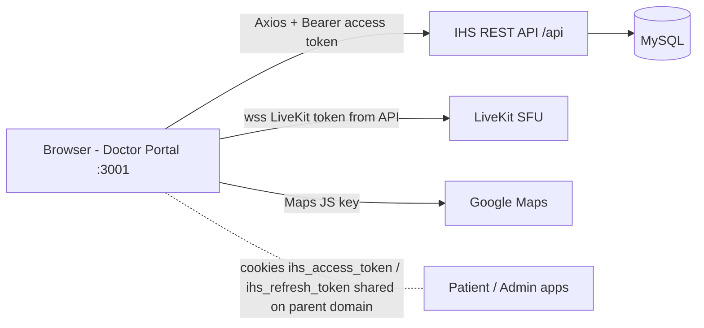

# IHS Doctor Portal (`frontend-doctor` / future repo `ihs-frontend-doctor`)

The web console that doctors use to run their practice on the India One Health System (IHS): sign up, get verified, publish a public portfolio, set clinics and availability, work through appointments and video consultations, record the clinical consultation in an EMR "Patient Workbench", sign prescriptions on a personal letterhead, and watch their analytics and earnings.

It is a **Next.js 16 (App Router) + React 19 + MUI 9 + TanStack Query 5** single-page-style app that talks only to the shared IHS REST API (Express/Sequelize/MySQL in `backend/`). It has no server-side data layer of its own: every Next.js page is a thin shell around a client component that calls the backend with Axios.

> Documentation scope: everything in this folder was written from the source in `frontend-doctor/src` (and cross-checked read-only against `backend/src/routes`). Items that could not be verified are marked as such. See `KNOWN-LIMITATIONS-AND-DISCREPANCIES.md`.

---

## 1. What it does

| Area | What the doctor can do | Status |
|---|---|---|
| Account | Register as a doctor (email + password, or Google), sign in with email **or** 10-digit mobile, reset password by 6-digit OTP (SMS/email) or emailed link | Implemented (verified) |
| Onboarding & verification | 3 required steps (professional details, specialties and languages, documents) then "Submit for verification"; status banner pending / under review / rejected / live | Implemented (verified) |
| Portfolio | Full public-profile editor (photo, hero images, about, education, experience, services, awards, publications, memberships, affiliations, fellowships, expertise, testimonials, gallery, FAQ, insurance, links, contact) with a live "as patients see it" preview and inline edit pencils | Implemented (verified) |
| Clinics and availability | CRUD clinics (Google-Maps pin optional), weekly consulting windows per clinic and for video, blocked dates | Implemented (verified) |
| Appointments | Board (Previous / Today / Future, Video / Hospital tabs, status filters, search), detail dialog, mark paid (UPI/cash), mark complete / no-show, reschedule, refer to another doctor | Implemented (verified) |
| Video consultations | LiveKit room per booking with side panels (history, description, prescription) and draggable picture-in-picture | Implemented (verified); the LiveKit URL + token come from the backend (needs backend `LIVEKIT_*` config) |
| Patient workbench (EMR) | Workbench list, per-patient workspace (vitals, complaint, examination, history, comorbidity, diagnosis with ICD search, investigations, medication order, notes, follow-up), consent-gated access to other doctors' records, 9 record pages | Implemented (verified) |
| Prescriptions | Draft generated from the workbench, form / letterhead views, server PDF preview, finalize, amend, history; letterhead (template) editor with logo / watermark / signature | Implemented (verified) |
| Medicines | Personal medicine master list linked to the IHS catalogue | Implemented (verified) |
| My Patients and timeline | Roster with doctor-set status, per-patient treatment timeline | Implemented (verified) |
| Follow-ups | Doctor-defined follow-up categories (name, colour, order) and per-visit follow-up date + automatic reminder | Implemented (verified) |
| Referrals | Send referral from a consultation; "Referrals to me" inbox with shared case + start walk-in consultation | Implemented (verified) |
| Dashboard 2.0 analytics | Five KPI sections, trends, patient-acquisition insights and six "Explore more" pages | Implemented (verified) |
| Earnings | Summary, series chart and auditable per-consult ledger | Implemented (verified) |
| Payment QR | Upload own UPI QR used for offline "UPI" payments | Implemented (verified) |
| Notifications | Bell with unread count and latest 8 items (shared notification feed, polled every 60 s) | Implemented (verified); no full page |

Pages that exist but are **not part of the doctor workflow** (legacy public-site code): `/about`, `/doctors/[slug]`; `/doctors`, `/map`, `/contact` redirect to the patient app; `/` redirects to `/login` or `/dashboard`.

---

## 2. Tech stack (summary)

Next.js 16.2.9 (App Router, Turbopack dev, `output: "standalone"`, React Compiler on), React 19.2.4, TypeScript 5 (strict), MUI 9 (+ x-data-grid, x-date-pickers, x-tree-view, lab), Emotion, TanStack Query 5, Axios, React Hook Form + Zod 4, LiveKit (`livekit-client`, `@livekit/components-react`), Google Maps (`@vis.gl/react-google-maps`), Recharts 3, framer-motion, Sonner toasts, js-cookie, react-pdf, react-dropzone, ESLint 9 (`eslint-config-next`). Full list: `TECH-STACK-AND-DEPENDENCIES.md`.

## 3. How it talks to the backend



* One Axios instance (`src/services/api.ts`) attaches `Authorization: Bearer <access>`, refreshes once on 401 (single-flight queue), retries safe methods on transport errors, and gives uploads a 180 s timeout.
* Success envelope `{ success, message, data }`; failure envelope `{ error: { message, code, details } }`.
* Tokens live in **cookies** (`ihs_access_token`, `ihs_refresh_token`) so Next's edge `proxy.ts` can gate `/dashboard` and so sibling IHS apps on the same parent domain share the session.
* Details: `API-INTEGRATION.md`, `AUTHENTICATION-AND-PERMISSIONS.md`.

## 4. Install and run

Requires Node 20 (the Jenkinsfile uses `node20`) and a reachable IHS backend.

```bash
cd frontend-doctor
cp .env.example .env.local        # then edit values (see below)
npm install                        # (the dev script also runs npm install via "predev")
npm run dev                        # next dev -p 3001  -> http://localhost:3001
```

Scripts (verbatim from `package.json`):

| Script | Command | Notes |
|---|---|---|
| `predev` | `npm install` | runs automatically before `npm run dev` |
| `dev` | `next dev -p 3001` | Turbopack dev server on port 3001 |
| `build` | `next build` | standalone production build; env is Zod-validated at build time |
| `start` | `next start -p 3001` | works locally, but production uses `node server.js` from `.next/standalone` (see `DEPLOYMENT-GUIDE.md`) |
| `lint` | `eslint .` | ESLint 9 flat config (`eslint.config.mjs`) |

There is **no test script** and no test files (see `TESTING-GUIDE.md`).

## 5. Environment variables

All are `NEXT_PUBLIC_*` (browser-visible, baked at build time) and validated in `src/config/env.ts`.

| Variable | Required | Default | Purpose |
|---|---|---|---|
| `NEXT_PUBLIC_API_URL` | **yes** (must be a URL) | none | Backend base URL including `/api` |
| `NEXT_PUBLIC_APP_NAME` | no | `Indian Health System` | Titles, brand |
| `NEXT_PUBLIC_ENV` | no | `development` | `development` / `staging` / `production` |
| `NEXT_PUBLIC_GOOGLE_CLIENT_ID` | no | empty | Enables Google sign-in button |
| `NEXT_PUBLIC_GOOGLE_MAPS_API_KEY` | no | empty | Interactive maps / Places search |
| `NEXT_PUBLIC_COOKIE_DOMAIN` | no | empty | Shared cookie domain for cross-app SSO |
| `NEXT_PUBLIC_PATIENT_URL` | no | `http://localhost:3000` | Redirect / link target to patient app |
| `NEXT_PUBLIC_DOCTOR_URL` | no | `http://doctor.localhost:3001` | This app's own URL (metadata base) |
| `NEXT_PUBLIC_ADMIN_URL` | no | `http://admin.localhost:3002` | Admin app URL (validated; not used by any component) |
| `NEXT_PUBLIC_LIVEKIT_URL` | no | empty | Validated into `env.livekitUrl` / `env.isVideoEnabled` but **not read by any component** (the join URL is returned by the backend in the video-token response). Keep it in sync with the backend `LIVEKIT_URL` anyway |
| `NEXT_PUBLIC_USE_MOCK_DOCTORS` | no | unset | Read directly via `process.env` in `doctor.service.ts`; `true` switches the legacy doctor-detail fetch to bundled sample data. Not in `.env.example` or the Zod schema |

Full detail: `ENVIRONMENT-CONFIGURATION.md`.

## 6. Build and deploy (summary)

* `npm run build` produces `.next/standalone` (self-contained `server.js`). The Jenkins pipeline copies `.next/static` and `public/` into it, rsyncs it to the VPS, and `pm2` runs `server.js` bound to loopback behind nginx. Production port 3001 (`ihs-doctor`), development port 3011 (`ihs-dev-doctor`).
* Full procedure: `DEPLOYMENT-GUIDE.md`.

## 7. Documentation index

| File | Contents |
|---|---|
| `APPLICATION-OVERVIEW.md` | Purpose, users, journey, feature status matrix |
| `ARCHITECTURE.md` | Layers, providers, data flow, diagrams |
| `FOLDER-STRUCTURE.md` | Real directory tree and conventions |
| `TECH-STACK-AND-DEPENDENCIES.md` | Every dependency with its role |
| `ROUTING-AND-NAVIGATION.md` | Every route, guards, sidebar, redirects |
| `AUTHENTICATION-AND-PERMISSIONS.md` | Login/registration/reset flows, tokens, role and consent model |
| `FEATURES-AND-MODULES.md` | Module-by-module behaviour (onboarding to analytics) |
| `API-INTEGRATION.md` | Axios client, envelopes, every endpoint consumed |
| `STATE-AND-DATA-FETCHING.md` | React Query keys, cache policy, forms, local state |
| `COMPONENTS.md` | Shared components, theme, design tokens |
| `ENVIRONMENT-CONFIGURATION.md` | Env vars in depth |
| `DEVELOPMENT-SETUP.md` | Local setup and conventions |
| `DEPLOYMENT-GUIDE.md` | Jenkins, standalone build, pm2 |
| `TESTING-GUIDE.md` | Current state and recommended checks |
| `TROUBLESHOOTING.md` | Symptoms and fixes |
| `KNOWN-LIMITATIONS-AND-DISCREPANCIES.md` | Honest gaps and old-doc vs code differences |
| `LEGACY-DOCUMENTATION-MAP.md` | Which old `docs/` folders relate to this app |

Shared system documentation lives outside this folder and is referred to by plain text only: `docs-shared/...` (architecture, database `dbstruct.md`, CI `jenkins-setup.md`).
