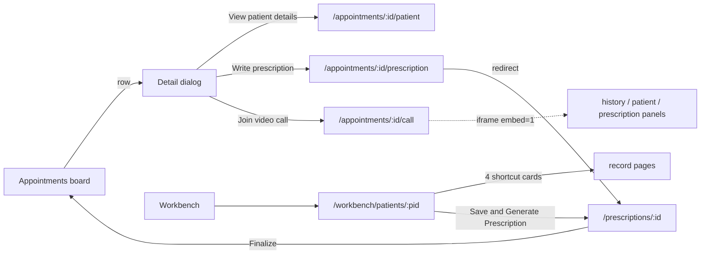

# Routing and Navigation

Routes are the folders under `src/app`. Route constants live in `src/constants/routes.ts` (`ROUTES`) - use them instead of string literals.

## 1. Route guard (`src/proxy.ts`)

Next 16 "proxy" (successor of `middleware`). Matcher: everything except `api`, `_next/static`, `_next/image`, `favicon.ico`, `icon.svg` and any path containing a dot.

| Condition | Result |
|---|---|
| `pathname === "/"` | 307 to `/dashboard` if a session cookie exists, else `/login` |
| path is `/dashboard` or under it, and **no** `ihs_access_token` **and** no `ihs_refresh_token` cookie | 307 to `/login?redirect=<path+query>` |
| path is an auth route (`/login`, `/register`, `/forgot-password`, `/reset-password`) and a session cookie exists | 307 to `/dashboard` |
| otherwise | continue |

It only checks cookie **presence**. A refresh token alone counts as a session; the real authority is the backend `authenticate` middleware, and `AuthProvider` + `DashboardShell` (client) handle an invalid session. After login, `useLogin` honours `?redirect=` only for same-origin paths starting with a single `/`.

## 2. Public / auth routes

| Route | Component | Notes |
|---|---|---|
| `/` | redirect by proxy | `app/page.tsx` (legacy marketing home) is never rendered |
| `/login` | `LoginForm` | email or mobile + password, Google button |
| `/register` | `RegisterForm` | doctor-only signup, Google button |
| `/forgot-password` | `ForgotPasswordPanel` | OTP (default) or emailed link |
| `/reset-password?token=` | `ResetPasswordForm` | token read server-side from `searchParams` |
| `/about` | `AboutPageContent` in `MainLayout` | legacy public page; not linked from the dashboard |
| `/doctors/[slug]` | `DoctorProfile` in `MainLayout` | legacy public profile; loads `GET /doctors/:slug` (or bundled sample data if `NEXT_PUBLIC_USE_MOCK_DOCTORS=true`) |
| `/doctors`, `/map`, `/contact` | `redirect()` | to `${NEXT_PUBLIC_PATIENT_URL}/doctors`, `/map`, `/contact` |
| not found / error / loading | `not-found.tsx`, `error.tsx` (global `ErrorState` with retry), `loading.tsx` | |

The `(auth)` group layout is a split-screen: navy brand panel (hidden below `md`) with static marketing text and stats, form column max 440 px.

## 3. Dashboard routes (all under `/dashboard`, wrapped by `DashboardShell`)

| Route | Feature component | Purpose | Live-gated in sidebar |
|---|---|---|---|
| `/dashboard` | `DashboardHome` | Overview: onboarding nudge, period filter, 5 KPI sections, shortcuts, acquisition, trends, today's schedule | always |
| `/dashboard/onboarding` | `OnboardingWizard` | 3 required steps + submit; not in sidebar (linked from banner/nudge) | n/a |
| `/dashboard/portfolio` | `PortfolioPreview` | "As patients see it" + inline edit; toggles to full `PortfolioEditor` | always |
| `/dashboard/settings` | `PortfolioEditor` + `PaymentQrCard` | step-by-step profile/portfolio editor + UPI QR | always |
| `/dashboard/clinics` | `ClinicsManager` | clinic CRUD | always |
| `/dashboard/availability` | `AvailabilityManager` | weekly windows per clinic + online + blocked dates | always |
| `/dashboard/appointments` | `AppointmentsBoard` | `?appointment=<id>` auto-opens the detail dialog | live only |
| `/dashboard/appointments/[id]/call` | call page (client) | LiveKit room + side panels | via board |
| `/dashboard/appointments/[id]/history` | `PatientHistoryView` (by booking) | treatment history; opened in new tab / panel | via board |
| `/dashboard/appointments/[id]/patient` | `PatientDescriptionView` | patient record page (own fonts) | via board |
| `/dashboard/appointments/[id]/prescription` | `PrescriptionGate` | finds/creates the booking's draft then redirects to `/dashboard/prescriptions/:id` | via board |
| `/dashboard/workbench` | `WorkbenchView` ("Patient Portal") | patient list + counts | live only |
| `/dashboard/workbench/patients/[patientId]` | `PatientWorkspace` | per-patient workspace, `?bookingId=` selects the visit | via workbench |
| `.../[patientId]/clinical-dashboard` | `ClinicalDashboardPage` | default clinical view (doctor-comparison timeline) | via workspace |
| `.../[patientId]/doctor-comparison` | `ClinicalDashboardPage page="doctor-comparison"` | | |
| `.../[patientId]/clinical-records` | `ClinicalRecordsPage` | consultations across doctors + timeline | |
| `.../[patientId]/medical-reports` | `MedicalReportsPage` | permitted documents by test date | |
| `.../[patientId]/diagnosis-records` | `DiagnosisRecordsPage` | diagnoses per doctor, evolution, comparison | |
| `.../[patientId]/treatment-summary` | `TreatmentSummaryPage` | signed prescriptions | |
| `.../[patientId]/medicine-dashboard` | `MedicineDashboardPage` | medicine analytics from signed prescriptions | |
| `.../[patientId]/reconciliation` | `ReconciliationPage` | states plainly that no backend model exists | |
| `.../[patientId]/audit-history` | `AuditHistoryPage` | doctor's own audit trail for the patient | |
| `/dashboard/patients` | `MyPatientsTable` | roster | live only |
| `/dashboard/patients/[patientId]` | `PatientProfileView`; `?view=timeline` -> `PatientHistoryView` (by patient) | read-only profile | via roster |
| `/dashboard/prescriptions` | `PrescriptionHistory` | all written prescriptions | live only |
| `/dashboard/prescriptions/[id]` | `RxComposer` | draft composer / locked record (same URL after finalize) | via history |
| `/dashboard/prescriptions/templates` | `TemplateList` | letterheads | link from prescriptions |
| `/dashboard/prescriptions/templates/[id]` | `TemplateEditor` | letterhead editor with A4 live preview | |
| `/dashboard/medicines` | `MedicineManager` | personal medicine master list | live only |
| `/dashboard/referrals` | `IncomingReferralsInbox` | "Referrals to me" | live only |
| `/dashboard/follow-up-options` | `FollowUpOptionsView` | follow-up categories | live only |
| `/dashboard/earnings` | `EarningsView` | summary, chart, ledger | live only |
| `/dashboard/analytics/{patients,appointments,financial,quality,productivity,acquisition}` | `*AnalyticsView` | "Explore more" pages; `?range=&from=&to=` carries the overview period | not in sidebar |

Dynamic segments are read with `await params` (server pages) or `useParams()` (client pages).

## 4. Sidebar (`features/dashboard/nav.ts`)

Order and gating (icon names are Feather icons):

| # | Label | Href | Icon | Requires live |
|---|---|---|---|---|
| 1 | Overview | `/dashboard` | FiGrid | no |
| 2 | My Portfolio | `/dashboard/portfolio` | FiUser | no |
| 3 | Patient Portal | `/dashboard/workbench` | FiActivity | yes |
| 4 | Appointments | `/dashboard/appointments` | FiCalendar | yes |
| 5 | My Patients | `/dashboard/patients` | FiUsers | yes |
| 6 | Follow-up options | `/dashboard/follow-up-options` | FiTag | yes |
| 7 | Referrals to me | `/dashboard/referrals` | FiShare2 | yes |
| 8 | Prescriptions | `/dashboard/prescriptions` | FiFileText | yes |
| 9 | My Medicines | `/dashboard/medicines` | FiBookOpen | yes |
| 10 | My Clinics | `/dashboard/clinics` | FiMapPin | no |
| 11 | Availability | `/dashboard/availability` | FiClock | no |
| 12 | Earnings | `/dashboard/earnings` | FiTrendingUp | yes |
| 13 | Settings | `/dashboard/settings` | FiSettings | no |

"Live" = `useOnboarding().verificationStatus === "approved"`. **Important:** the gating hides menu items only. The routes themselves are not blocked client-side; the backend enforces what an unverified doctor can do. A doctor who types `/dashboard/appointments` while pending will reach the page.

Behaviour of the shell: desktop sidebar is a 76 px icon rail that expands to 264 px on hover/focus-visible (overlaying content) or when pinned (pin stored in `localStorage` key `ihs.doctor.sidebarPinned`); below `md` it becomes a temporary drawer opened by the menu button. Top bar: pin toggle, page title (from the active nav item), "IHS home page" link to the patient site, `NotificationBell`, account menu (My portfolio, Settings, IHS home page, Sign out).

## 5. Navigation flows worth knowing

* After finalizing a prescription the composer routes to `/dashboard/appointments?appointment=<bookingId>` (mark-complete flow); inside an iframe it instead posts `{ type: "ihs:rx-finalized" }` to the parent window (origin-checked), and the call page returns to full screen.
* Appointment history/description open in the call page as same-origin iframes with `?embed=1` so the call is never unmounted; `DashboardShell` also detects `window.self !== window.top`.
