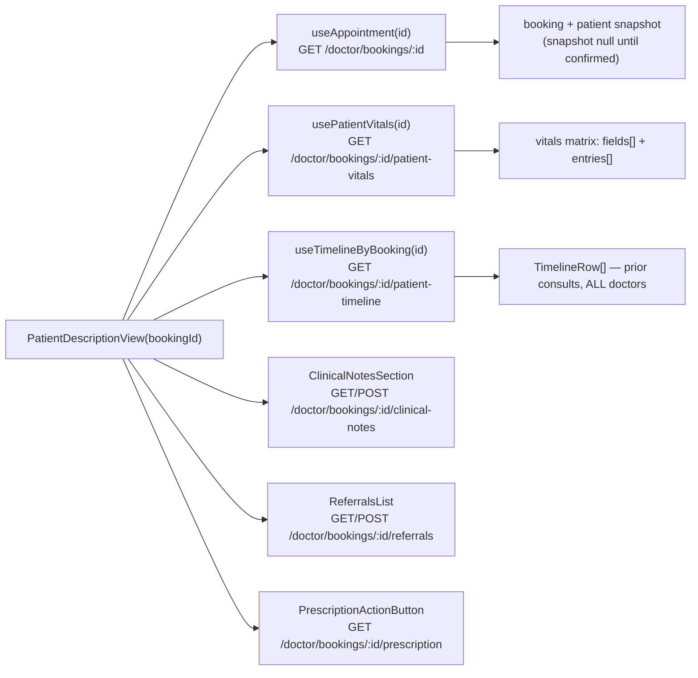

# The Patient Record page (doctor app)

`/dashboard/appointments/[id]/patient` — e.g. `http://localhost:3001/dashboard/appointments/11/patient`

> The doctor's full view of one patient, laid out as **one scroll grouped by date**, opened from an
> appointment they own. It is where a consultation is actually conducted: read the patient, check
> vitals and documents, write notes, prescribe, refer.

**Route file:** [page.tsx](<../frontend-doctor/src/app/(dashboard)/dashboard/appointments/[id]/patient/page.tsx>)
**Component:** [PatientDescriptionView.tsx](../../src/features/appointments/components/PatientDescriptionView.tsx) (~1,125 lines)

---

## Table of contents

1. [What the page is](#1-what-the-page-is)
2. [How you get here](#2-how-you-get-here)
3. [Access model — the unlock rule](#3-access-model--the-unlock-rule)
4. [Data sources](#4-data-sources)
5. [Page anatomy, top to bottom](#5-page-anatomy-top-to-bottom)
6. [The date-grouping algorithm](#6-the-date-grouping-algorithm)
7. [Document bucketing](#7-document-bucketing)
8. [Every write action](#8-every-write-action)
9. [The two query params](#9-the-two-query-params)
10. [Dialogs](#10-dialogs)
11. [Cache keys and invalidation](#11-cache-keys-and-invalidation)
12. [Design decisions, and why](#12-design-decisions-and-why)
13. [Edge cases, gaps and bugs found](#13-edge-cases-gaps-and-bugs-found)

---

## 1. What the page is

The `:id` in the URL is a **booking id**, not a patient id. Everything on the page is reached
*through* an appointment the signed-in doctor owns — that booking is both the access credential and
the anchor date.

Two ideas drive the whole layout, and they are stated in the component's own docblock:

1. **The date is the heading.** Everything below it is what was true on or before that day, and a
   prescription written here binds to *that* booking. Reaching this page from the treatment timeline
   opens a **past** consultation, and without the date dominating the screen that is invisible.
2. **Nothing readable is hidden behind a click.** Sections are tinted and stacked so a doctor scans
   by scrolling instead of opening tabs one at a time.

It is the page the appointment dialog's compact snapshot links out to — the dialog gives the summary,
this gives the record.

---

## 2. How you get here

| From | Link | Params |
|---|---|---|
| **Appointment detail dialog** → patient snapshot panel | `ROUTES.dashboard.patientDescription(booking.id)` | none |
| **Treatment timeline** row → "View details" ([PatientHistoryView.tsx:106](../../src/features/timeline/components/PatientHistoryView.tsx#L106)) | same | `?from=history` |
| **My Patients** roster row ([MyPatientsTable.tsx:195](../../src/features/timeline/components/MyPatientsTable.tsx#L195)) | via `p.lastBookingId` | `?from=history` |
| **Live video call** side panel ([call/page.tsx:86](<../frontend-doctor/src/app/(dashboard)/dashboard/appointments/[id]/call/page.tsx#L86>)) | rendered in an `<iframe>` | `?embed=1` |

Route helper: [`ROUTES.dashboard.patientDescription(bookingId)`](../../src/constants/routes.ts#L40).

### The Suspense boundary is load-bearing

```tsx
<Suspense fallback={<Loading label="Loading patient details…" />}>
  <PatientDescriptionView bookingId={id} />
</Suspense>
```

The view reads `useSearchParams()`, and Next **fails the production build** on an unwrapped
`useSearchParams` in a statically-rendered subtree. Dev never complains — without this wrapper the
failure surfaces at deploy time.

---

## 3. Access model — the unlock rule

Every endpoint this page calls runs through the **same** gate, so the page cannot have one section
open and another leaking:

```js
// backend/src/services/patientVitals.service.js
async function gateBookingPatient(doctorId, bookingId) {
  const booking = await Booking.findOne({
    where: { id: bookingId, doctorId },          // ownership is a WHERE, never a post-load if
    attributes: ["id", "patientId", "status"],
  });
  if (!booking) throw ApiError.notFound("Booking not found");
  if (!UNLOCKED.includes(booking.status)) {       // ['confirmed', 'completed']
    throw ApiError.forbidden("Patient details unlock once the booking is confirmed");
  }
  return booking;
}
```

Consequences:

- **Another doctor's booking 404s.** It is not a 403 — a 403 would confirm the booking exists.
- **A `pending_payment` booking is locked.** The page renders a padlock card:
  *"Patient details unlock once the booking is confirmed."* A doctor cannot read patient data off an
  unpaid hold.
- **The page takes no patient parameter.** The patient is derived from a booking the doctor owns, so
  the URL cannot be pivoted to somebody else's patient by editing an id.
- `clinicalNote.service.assertBookingUnlocked` is a byte-identical twin of this gate, and
  `treatmentTimeline.listByBooking` calls `gateBookingPatient` directly — one rule, three services.

Data returned is **patient-wide**, not booking-scoped: every note, every vitals reading, every
document the patient has, across all their doctors. The booking authorises; it does not filter.

---

## 4. Data sources



| Hook | Endpoint | Returns |
|---|---|---|
| `useAppointment(bookingId)` | `GET /doctor/bookings/:id` | `{ booking, patient }` — the snapshot is `null` unless confirmed/completed |
| `usePatientVitals(bookingId)` | `GET /doctor/bookings/:id/patient-vitals` | `{ fields[], entries[] }` matrix, each entry age-banded server-side |
| `useTimelineByBooking(bookingId)` | `GET /doctor/bookings/:id/patient-timeline` | `{ rows[], years[], total, capped }` — completed consults across **all** doctors |
| `useClinicalNotes(bookingId)` | `GET /doctor/bookings/:id/clinical-notes` | patient-wide note log, newest first |
| `useBookingPrescription(bookingId)` | `GET /doctor/bookings/:id/prescription` | the live prescription, or 404 = "none yet" |
| `usePrescriptionPdf(rxId)` | `GET /doctor/prescriptions/:id/pdf` | PDF blob |

**The patient snapshot** (`serializePatientSnapshot`) carries: name, phone, photo, age (derived from
DOB), DOB, gender, blood group, address, **allergies** (+severity), **conditions** (+diagnosed year),
**current medications**, and **uploaded records** (with row ids, so dates can be corrected in place).

---

## 5. Page anatomy, top to bottom

```
┌───────────────────────────────────────────────────────────────────┐
│ ← Back to appointments                                            │
├─────────────────────────────────┬─────────────────────────────────┤
│ A — WHO THE PATIENT IS   (7/12) │ B — ALLERGIES & HISTORY  (5/12) │
│ avatar · name · age·sex·blood   │ ♥ Allergies      [chips]        │
│ ·city          [Rx action btn]  │   Chronic conditions            │
│ ─────────────────────────────── │   Current medications           │
│ DOB    │ Phone   │ Address      │ tinted warning if allergies,    │
│                                 │ success if none                 │
├─────────────────────────────────┴─────────────────────────────────┤
│ ██ STICKY ██  Tuesday, 14 July 2026   [Today|Past]  [completed]   │
├───────────────────────────────────────────────────────────────────┤
│ [Filter by date ▾] [Clear]                    [Add vitals reading]│
├───────────────────────────────────────────────────────────────────┤
│ ▌ 14 Jul 2026                                     [This visit]    │  ← primary tint
│ ▌  Vitals ──────────  (colour-coded record table)                 │
│ ▌  Consultation ────  10:30 · You · Video · ₹500                  │
│ ▌  Documents ───────  [Prescription][Report][X-ray][MRI]          │
├───────────────────────────────────────────────────────────────────┤
│ ▌ 02 Jul 2026                                                     │  ← info tint
│ ▌  Vitals · Consultation(s) · Documents                           │
├───────────────────────────────────────────────────────────────────┤
│              [Load older dates]  Showing 20 of 63 dates           │
├───────────────────────────────────────────────────────────────────┤
│ ✎ Clinical notes  ("Tests & Reports")            [Add]            │
├───────────────────────────────────────────────────────────────────┤
│ + Referrals                        [Refer to another doctor]      │
└───────────────────────────────────────────────────────────────────┘
```

### Card A — identity
Avatar (photo or initials), name, and a `·`-joined demographic line (age · gender · blood group ·
city, state). Then three `Fact`s: **Date of birth**, **Phone**, **Address**. The
`PrescriptionActionButton` is anchored top-right.

The demographic **chip row that used to repeat Age/Gender/Blood group** over the grid below it was
removed — per the code comment, "the single biggest waste of space on the page, saying everything
twice."

### Card B — allergies & history
The "what must I not do before prescribing" card. Tinted **warning** when allergies exist, **success**
when none. Three lines, each a question with an answer:

| Line | Empty state |
|---|---|
| Allergies (warning chips, `name · severity`) | "None known" |
| Chronic conditions (`name (year)`, comma-joined) | "None recorded" |
| Current medications (`name dosage frequency`) | "None recorded" |

Cards A and B sit **side by side** (7/12 + 5/12 on `md+`) specifically so the clinical record starts
above the fold rather than a screen and a half down.

### The sticky date header
```
Tuesday, 14 July 2026   [Today] or [Past consultation — not today]   [status]
```
`position: sticky`, offset by the dashboard app bar height (`{ xs: 56, sm: 64 }`, or `0` when
embedded). It stays answerable on a long scroll: everything below is "as of" this consultation.

The **"Past consultation — not today"** warning lives here rather than beside the prescription button
— it is a fact about the whole page, not about one control.

### The toolbar
- **Filter by date** — narrows to *exactly* the chosen day. It **filters, it does not scroll**: the
  record pages 20 days at a time, so the target date may not be mounted yet, and "scroll to it" would
  fail silently on exactly the old dates a doctor reaches for the picker to find.
- **Add vitals reading** — opens `AddPatientVitalsModal`.

### The date blocks — the core of the page
One `Paper` per date, newest first, with a **5px left border** as a timeline accent:

| | Consultation's own date | Any other date |
|---|---|---|
| Tone | `primary` | `info` |
| Chip | `[This visit]` | — |
| Empty sub-sections | rendered ("No readings taken", four empty document columns) | hidden |

Each block contains up to three sub-sections under a `MiniHeading` (17px, weight 800, ruled — a
heading that actually reads as a heading, after a revision where headings, labels and values all
looked identical):

1. **Vitals** — the *same* `HealthRecordTable` the patient sees, scoped to this date, with the colour
   legend on the first block only and the Date column hidden (the block header already is the date).
   Reusing the shared table keeps **one** definition of "above range"; re-rendering the numbers as
   plain chips is how a high pulse stops being obvious.
2. **Consultation(s)** — every visit on this date, each in its own bounded card, identified by
   **time** (the only thing that reliably differs between two visits on one day). The current booking
   appears with a `[This visit]` chip and its fee; prior consults show doctor, speciality, issue and
   prescription number.
3. **Documents** — the four-bucket row (see §7).

### Pagination
`PAGE_SIZE = 20` dates. An `IntersectionObserver` with `rootMargin: "300px"` on a sentinel loads the
next 20 — wired through a **callback ref, not an effect**, so it fires exactly when the sentinel
mounts/unmounts with no dependency array to keep in sync and no synchronous `setState` in an effect
body. The **"Load older dates" button is not a JS fallback** — it is the keyboard and screen-reader
path, since "scroll until more appears" is not an affordance those users have.

### Clinical notes
`SectionCard` (primary tone) wrapping `ClinicalNotesSection` — one note at a time, latest first, with
prev/next navigation and an inline append form. Append-only; notes are never edited or deleted.
Fields: **Complaints (C/O)**, **On examination (O/E)**, **History — Medical**, **History — Surgical**,
**Diagnosis**, **Treatment**, plus the six vitals.

> The section's visible heading reads **"Tests & Reports"** while the card title says "Clinical
> notes" — see §13.

### Referrals
`SectionCard` (secondary tone) with `ReferralsList` and a **Refer to another doctor** button opening
`ReferDoctorDialog`, seeded with `sourceClinicId` and the patient's name.

---

## 6. The date-grouping algorithm

This is the page's central idea. A vitals reading taken on the 15th and a report dated the 30th are
two different days in the patient's history — listing them in one flat table under today's heading
says they happened today, which is simply false.

```js
const byDate = new Map();                       // key: "YYYY-MM-DD"

for (const e of vitalEntries)      bucket(e.recordedOn).vitals.push(e);
for (const r of uploadedRecords)   bucket(r.recordDate ?? r.uploadedAt).records.push(r);
for (const c of history.rows)      bucket(c.date).consults.push(c);

bucket(booking.date);                           // this consultation's day, ALWAYS present

return [...byDate].map(...).sort((a, b) => b.date.localeCompare(a.date));   // newest first
```

Four things worth noting:

- **Documents fall back to `uploadedAt`** when `recordDate` is unset — and the doctor can correct
  that date, which physically **moves the document to another block**.
- **Prior consultations across all doctors** are folded into their own date's block rather than
  living in a second table that repeats the visit already shown above.
- **The consultation's own date is always bucketed**, even when nothing was recorded on it — so the
  visit the doctor came here for never silently disappears from its own page.
- Keys are `"YYYY-MM-DD"` strings, so `localeCompare` sorts them correctly and `sameDay()` is a
  10-character prefix compare.

Then: `jumpDate` filters to exactly one date → `.slice(0, visibleCount)` pages it.

---

## 7. Document bucketing

Four columns, always in this order: **Prescription · Report · X-ray · MRI**.

```js
function bucketOf(r) {
  const tag = `${r.tag ?? ""}`.toLowerCase();
  if (/\bmri\b|magnetic resonance/.test(tag))  return "mri";
  if (/x-?ray|radiograph|\bxr\b/.test(tag))    return "xray";
  if (r.fileType === "prescription")           return "prescription";
  return "report";                              // the catch-all
}
```

`uploaded_records.file_type` stores all four categories (migration 021), so the patient picks the real
category at upload. **Rows created before that migration fall back to matching the label** — hence the
regex pass on `tag` running *before* the `fileType` check.

**`showEmpty` is true only on the consultation's own date.** There, empty columns are a useful
checklist — "no MRI on file" is an answer, and a column that vanishes when empty makes the doctor
re-scan the row every time to work out which categories they are even looking at. Everywhere else it
is false, and that matters at scale: a patient with a year of history has hundreds of date blocks, and
four "None" columns on every one of them buries the handful of real documents in a wall of nothing.

Each document row has an **eye icon** (open in `ReportViewerDialog`) and, when the row has an id, a
**calendar icon** (correct its date).

---

## 8. Every write action

| Action | Trigger | Endpoint | Effect |
|---|---|---|---|
| Add vitals reading | Toolbar button | `POST /doctor/bookings/:id/patient-vitals` | Stored with `source: 'doctor'`; response **is** the refreshed matrix, written straight into cache (no refetch) |
| Add clinical note | Notes section → Add | `POST /doctor/bookings/:id/clinical-notes` | Appended patient-wide; list invalidated |
| Correct a document's date | Calendar icon on a document | `PATCH /doctor/bookings/:id/patient-records/:recordId` | Date only — file and label stay the uploader's; document **moves** to the corrected date's block |
| Write / continue prescription | Card A button | navigates to `/dashboard/appointments/:id/prescription` | — |
| View finalized prescription | Card A button | `GET /doctor/prescriptions/:id/pdf` | Opens `RxPdfPreviewDialog` in place |
| View a past consult's Rx | "View PDF" on a history row | same | See §13 for how cross-doctor access is granted |
| Refer to another doctor | Referrals section | `POST /doctor/bookings/:id/referrals` | Opens/joins a care journey |

### The prescription button's four states

```
booking not confirmed/completed  →  nothing renders at all
confirmed/completed, no Rx       →  "Write prescription"
draft exists                     →  "Continue draft"
finalized exists                 →  "View prescription" (+ Rx number underneath)
```

A `404` from `GET /doctor/bookings/:id/prescription` means *"no prescription yet"* — the normal case,
explicitly not treated as a failure.

---

## 9. The two query params

### `?from=history` — read-only mode

Set when the page is reached from the treatment timeline or the My Patients roster, i.e. **while
looking at a past consultation**. It hides every prescription *write* action and leaves only "View".

The reason is recorded verbatim in `PrescriptionActionButton`:

> A prescription written there binds to that old booking — a doctor mid-video-consult did exactly
> that and the prescription landed on a visit from four days earlier. **Reading history must never be
> one click from writing onto it.**

In read-only mode the button is replaced by explanatory text: *"No prescription for this
consultation. To write one, open the appointment it belongs to."*

Note the scope: it gates **prescriptions only**. Vitals, clinical notes and referrals remain writable
from a history view.

### `?embed=1` — video-call panel mode

Set when the page is rendered inside the live call's side-panel `<iframe>`. Its only effect is the
sticky header offset: without it the header pins 64px down (allowing for a dashboard app bar that does
not exist in the iframe) and floats over the content mid-scroll instead of sitting flush at the top.

---

## 10. Dialogs

| Dialog | Purpose |
|---|---|
| `ReportViewerDialog` | Pan/zoom viewer for a document. Detects images by extension and gives real zoom (+/− buttons, mouse wheel, click-drag, multi-touch pinch with `touchAction: none`). An X-ray in a scrollable box is unreadable — you only ever see a strip and the two scrollbars fight the content. Panning unlocks only once zoomed in. |
| `EditRecordDateDialog` | One date field, seeded from `recordDate ?? uploadedAt`, capped at today. Copy explains it: "the day the prescription was written or the test was done, not the day it was uploaded." Re-seeds on open via adjust-state-during-render, not an effect. |
| `AddPatientVitalsModal` | Date + location autocomplete + the six vitals + note. |
| `RxPdfPreviewDialog` | Streams a prescription PDF blob with retry. |
| `ReferDoctorDialog` | Target autocomplete (approved + active + not self), reason (min 3 chars), optional note. |

---

## 11. Cache keys and invalidation

```ts
queryKeys.appointments.detail(bookingId)         // ["appointments","detail",id]
queryKeys.appointments.patientVitals(bookingId)  // ["appointments","patient-vitals",id]
queryKeys.appointments.clinicalNotes(bookingId)  // ["appointments","clinical-notes",id]
["doctor","timeline","booking",bookingId,year,month,sort]
```

- **Add vitals** → `setQueryData` on the matrix key. The endpoint returns the whole refreshed matrix,
  so the table *and* the prescription composer's vitals prefill both update with zero refetches.
- **Correct a record date** → invalidates `appointments.detail` (the snapshot owns the records).
- **Add note** → invalidates `appointments.clinicalNotes`.

The timeline keys deliberately keep `"booking"` and `"patient"` scopes **distinct**. Both paths return
the identical shape, so a shared key would let a cached booking-scoped result be served to the
patient-scoped page — showing one patient's history under another patient's name.

---

## 12. Design decisions, and why

Pulled from the code's own comments; each replaced something that had actually gone wrong.

| Decision | The problem it fixed |
|---|---|
| Date is the page heading, sticky | Opening a *past* consultation from the timeline was invisible; doctors acted as if it were today |
| Cards A and B side by side | The clinical record used to start a screen and a half down |
| Demographic chip row deleted | It repeated Age/Gender/Blood group verbatim over the grid directly below it |
| `MiniHeading` is dark, large, sentence case, ruled | Headings, field labels and values were all small grey uppercase — nothing announced itself as a heading |
| `Fact` — quiet label, **loud value** | The reverse of what it was; values wrap instead of truncating, because a clipped clinic name is worse than a second line |
| Record grouped by date | A flat table under today's heading claimed a reading from the 15th happened on the 31st |
| Date picker filters, not scrolls | The target date is often not mounted yet under 20-day paging — "scroll to it" failed silently on exactly the old dates the picker exists to find |
| Left border accent, no left rail | A separate 132px date rail sat empty for the whole height of a tall card |
| Visits identified by **time** | Rendering the current booking as "Consultation" and others as "Also on this date" made two visits read as one visit described twice |
| Reuse `HealthRecordTable` | A second, colourless rendering of the same numbers is how a high pulse stops being obvious |
| `showEmpty` only on the consult's date | Four "None" columns on hundreds of date blocks buried the real documents |
| Sections tinted, never collapsed | A doctor reading a patient wants to scan, not to open things |
| Colour is navigational, never semantic | Nothing on the page is communicated by colour alone |
| `?from=history` read-only | A doctor mid-consult prescribed onto a booking from four days earlier |
| Callback ref for the observer | No dependency array to desync, no `setState` in an effect body |

All tints derive from the theme via `alpha()` — no hardcoded hex — so both colour schemes work from
one set of values.

---

## 13. Edge cases, gaps and bugs found

Factual observations from reading the current code.

1. **"Recorded by Dr X" can name the wrong person, or nobody.** In the vitals sub-block:
   ```tsx
   {g.vitals.some((e) => e.recordedBy?.name) && (
     <Typography>{g.vitals[0].recordedBy?.name ? `Recorded by Dr ${g.vitals[0].recordedBy.name}` : ""}</Typography>
   )}
   ```
   Two problems. The guard tests **some** entry but the body reads **`[0]`** — if the first reading of
   a date has no author but a later one does, the guard passes and an empty line renders. And the
   `Dr ` prefix is unconditional, while `recordedBy` is whoever authored the row — a **patient**-
   recorded reading (`source: 'patient'`) renders as "Recorded by Dr «patient's name»". The entry's
   `source` field is available and is what should drive the prefix.
   ([PatientDescriptionView.tsx:908-912](../../src/features/appointments/components/PatientDescriptionView.tsx#L908-L912))

2. **The clinical-notes heading contradicts itself.** The `SectionCard` title is "Clinical notes"
   while the heading rendered inside `ClinicalNotesSection` reads "Tests & Reports", as do its empty
   state and error text. The data is clinical notes (C/O, O/E, diagnosis, treatment) — the inner
   labels look like a leftover from an earlier naming.

3. **`REPORT_TYPE_LABELS` is missing the two newest types.** It maps only
   `prescription | lab_report | other`, but migration 021 added `xray` and `mri`. `reportType()` falls
   back to the raw enum string, so an X-ray opened without a `tag` gets a viewer titled `xray` rather
   than "X-ray". Cosmetic and only on the fallback path — `DocumentBuckets` classifies correctly.

4. **A stale type comment.** [types/timeline.ts](../../src/types/timeline.ts) says
   *"`id` is null and `canView` false for a DOCTOR viewer — the PDF is patient-only."* The backend no
   longer does this: `serializeTimelineRow` has `void viewer; const canView = true;`, and
   `getPdfForDoctor` grants access to another doctor's finalized prescription **when the caller has a
   confirmed/completed booking with that patient**. So the "View PDF" button on past-consultation rows
   does work. The comment should be corrected before someone "fixes" the UI to match it.

5. **Date parsing is UTC-based here, local elsewhere.** `isToday`, `fmtDate`, `dayMonth` and `yearOf`
   all use `new Date("YYYY-MM-DD")`, which parses as **UTC midnight**, then format in local time. In
   IST (UTC+5:30) this lands at 05:30 the same day and is correct; in a negative-offset zone it would
   render the previous day. The appointments board uses the local-safe `` new Date(`${d}T00:00:00`) ``
   form. Not a live bug for an India-only product, but the two files disagree.

6. **The timeline's 200-row cap is not surfaced.** `useTimelineByBooking` returns `capped: true` when a
   patient has more than 200 completed consultations, and this page ignores it — older visits silently
   stop appearing. The dedicated history page does report it.

7. **`jumpDate` filters to exactly one day.** Deliberate, and the helper text says "Showing this date
   only" — but there is no range option, so finding "sometime last March" still means paging.

8. **Locked state is a dead end.** When the booking is not yet confirmed the page renders only a
   padlock and "Back to appointments" — correct, but it does not say *which* status would unlock it or
   link to the appointment to confirm it.
